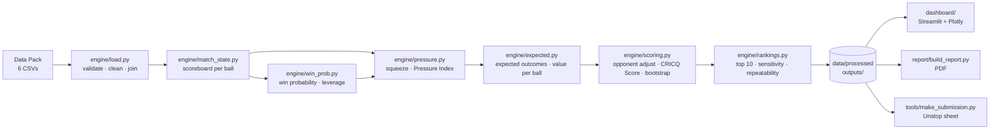

# CRICQ — Architecture

## System overview

`pipeline.py` runs the engine top to bottom; the dashboard, the report and the submission sheet only **read** its
outputs. That separation is the main design rule: everything users see comes from one reproducible run, and the UI
never recomputes a model.

## Layers

| Layer | Modules | Responsibility | Depends on |
|---|---|---|---|
| Configuration | `config.yaml`, `engine/config.py`, `engine/validation.py` | Every tunable number; validated on load with readable errors | — |
| Ingestion | `engine/load.py` | Read, schema-check and join the six CSVs; extras coding; team tiers; player directory; data-quality log | validation |
| Modelling | `match_state`, `win_prob`, `pressure`, `expected` | Scoreboard, win probability, Pressure Index, expected outcomes, value per ball | pandas, scikit-learn |
| Rating | `scoring`, `rankings` | Opponent adjustment, anchored empirical-Bayes estimates, CRICQ Score, bootstrap, eligibility, robustness tests | modelling |
| Parameters | `factors` | Tags every ball by phase, innings, wickets in hand, collapse, pitch type, opposition, stage, competition, bowler type, batter hand, pressure, RR home; per-player splits, head-to-heads, situation scout | modelling |
| Auction | `availability`, `auction`, `data/external/*.csv` | IPL 2027 status per player: hard facts → news consensus (weighted outlets) + 2026 playing time → P(released); RR squad state, needs, targets, shortlist, projected XI, watch list | rating |
| Orchestration | `pipeline.py` | CLI, logging, ordering, writing outputs, the model report | all engine modules |
| Presentation | `dashboard/` (app, `components/`, `views/`), `report/` | Read-only views of the outputs | outputs only |
| Tooling | `tools/`, `tests/`, CI | Password hash, submission sheet, checksums, tests, lint | — |

## Data contracts (pipeline → consumers)

| File | Grain | Key columns |
|---|---|---|
| `data/processed/balls.parquet` | one row per delivery | `match_id, innings, innings_ball_num`, scoreboard state, `wp, leverage, squeeze, pressure_index, high_pressure`, `x_runs, x_out, bat_value, bowl_value, bat_adj, bowl_adj` |
| `data/processed/matches.parquet` | one row per match with balls | innings totals, `pressure_balls, peak_pressure`, result |
| `data/processed/players.parquet` | one row per player | `player_id, display_name, team_label, bat_hand, bowl_type, pace_spin` |
| `outputs/batting_scores.csv`, `bowling_scores.csv` | one row per player | components, `clutch_score, score_lo/hi, rank_lo/hi, p_top10, top10_in_variants, eligible, rank`, plain stats |
| `outputs/top10_*.csv` | 10 rows | the submission lists (eligible **and** able to play IPL 2027) |
| `outputs/auction_*.csv` | needs / targets / plan / xi / watch / unavailable | the default RR auction board (dashboard recomputes it live) |
| `outputs/player_factors.parquet` | one row per player × parameter × level × role | `balls, runs, outs, rate, per100`, same with `p_` for pressure balls |
| `outputs/matchups.parquet` | one row per batter × bowler (6+ balls) | `balls, runs, outs, value`, `p_*` under pressure |
| `data/external/retention_reports_2027.csv` (input) | one row per outlet × player | `player, team, verdict, source, url, date, kind` |
| `data/external/player_status_2027.csv` (input) | one row per player with a known status | `player, status, team_2027, note, source, source_date` |
| `data/external/rr_squad_2027.csv` (input) | one row per RR squad player | `player, overseas, fee_cr, covers, projection, reason, source` |
| `outputs/model_report.json` | one document | validation metrics, settings used, data summary |

## Key design decisions

1. **Players keyed by ID, never by name.** Three names belong to two players each.
2. **Cross-fitting everywhere.** Every win-probability and expected-outcome prediction comes from a model that never
   saw that ball's match (5-fold `GroupKFold` by match), so player values are not inflated by over-fitting.
3. **Monotonic constraints** on the win-probability models so they always respect cricket logic.
4. **Situation-only features** in the expected-outcome models: a player is compared with an average player in the
   same spot, never with themselves.
5. **Anchored estimates.** Pressure ability = overall ability adjusted by the pressure record, with the anchor
   strength chosen by an out-of-sample test — because pressure-only samples are small and noisy.
6. **Honest uncertainty.** Bootstrap ranges and sensitivity tests are first-class outputs, shown in the UI.
7. **Read-only presentation.** The dashboard cannot change results; the only inputs it accepts are filters.
8. **Security by default.** Local-only server, optional password guarding every route, escaped output, no uploads
   (see `SECURITY.md`).

## Performance

Full pipeline ≈ 70 s on a laptop (200k deliveries): win-probability cross-fitting ≈ 30 s, expected-outcome models
≈ 20 s, scoring + bootstrap ≈ 2 s, 10 sensitivity variants ≈ 6 s. The dashboard caches every table in memory
(`st.cache_data`) and per-player splits on first use.

## Extending

- **New pressure ingredient:** add a column in `pressure.add_squeeze`, include it in `add_pressure`, expose its weight
  in `config.yaml` and `validation.validate_config`, and add a sensitivity variant in `rankings.sensitivity`.
- **New dashboard page:** add `dashboard/views/<name>.py` and register it in `dashboard/app.py` (after
  `auth.require_login()` so it is protected). Never create a `dashboard/pages/` folder.
- **New season of data:** drop the new CSVs in and run `python pipeline.py`; seasons are detected automatically and
  recency weights update.
