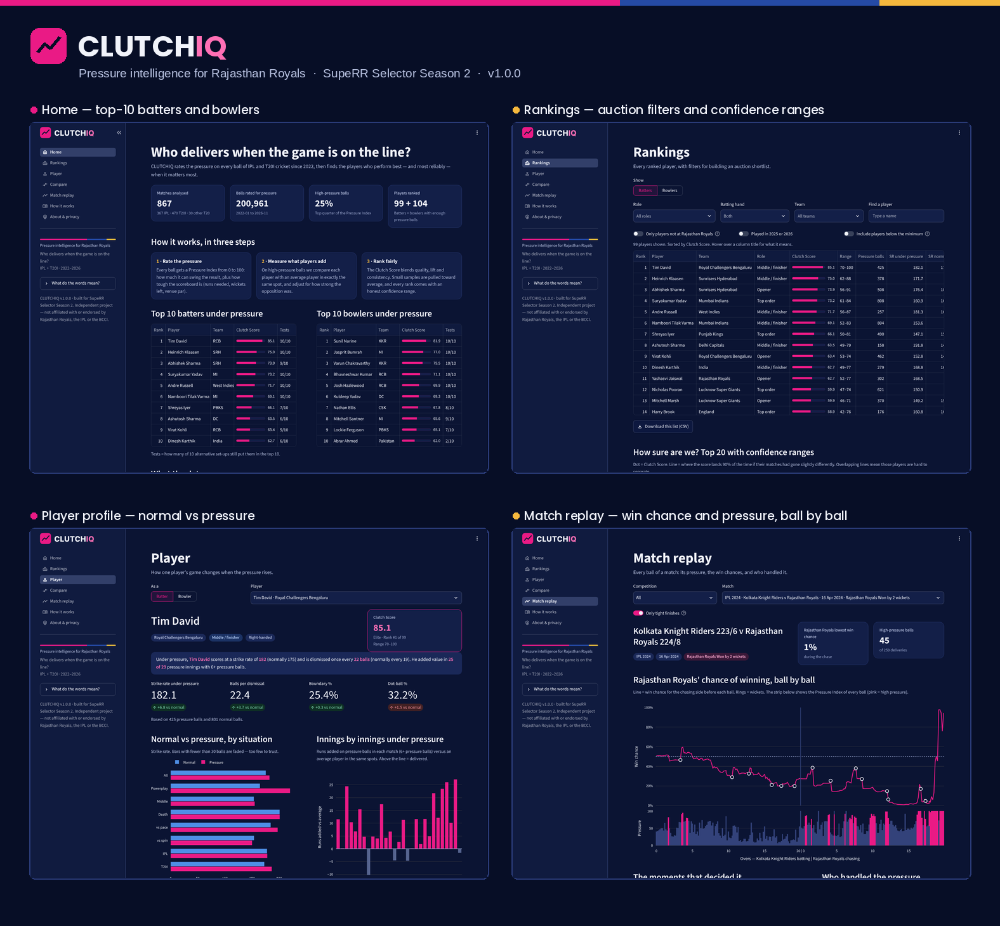

# CRICQ — Who delivers when the game is on the line?

**Pressure intelligence for Rajasthan Royals · SupeRR Selector Season 2 (Round 1) · v1.6.0**

CRICQ rates the pressure on every ball of IPL and T20I cricket since 2022 (200,961 balls, 867 matches), measures
what every batter and bowler added on the highest-pressure balls compared with an average player in the same spot,
and ranks the most reliable players under pressure — with honest confidence ranges. The **RR Auction Board** then
turns those rankings into an IPL 2027 auction plan: who RR keeps, where the squad is short under pressure, and which
players are actually available to buy. Availability is a consensus of every outlet's retention call plus how often each
franchise picked the player in 2026 — so stars their teams will keep (Tim David at RCB, Rohit Sharma at MI) are never
treated as targets. Every player is also measured across the cricket parameters selectors use: phase, setting or
chasing, wickets in hand, collapses, pitch type, opposition strength, knockouts, bowler type, batter hand, RR's home
venues and head-to-head matchups.



## Quick start (Windows)

1. Install **Python 3.10 or newer** from python.org (tick **"Add Python to PATH"**).
2. Put this `cricq` folder next to your `CRICQ DATASET` folder (or copy the 6 CSVs into `data/raw/`).
3. Double-click **`setup.bat`** once.
4. Double-click **`run_dashboard.bat`** — the dashboard opens in your browser at http://localhost:8501.
5. Optional: **`open_in_vscode.bat`** opens the project in VS Code (Terminal → Run Task → *CRICQ: Run dashboard*).

Processed data and results are included, so the dashboard works immediately. Full guide: [docs/USER_GUIDE.md](docs/USER_GUIDE.md).

## What's in the box

| Path | What it is |
|---|---|
| `submission/UNSTOP_ENTRY.md` | **The two top-10 lists to enter on Unstop**, in order |
| `report/CRICQ_Methodology_Report.pdf` | **The methodology report to upload** |
| `dashboard/` | Streamlit + Plotly app. **Round 1:** Home (the two top-10 lists), Player cards, Rankings, Player profile, Compare · **Selector tools:** Situation scout, Matchups, Auction board (extra) · **Evidence:** Match replay, How it works, About & privacy |
| `Player Image/` | **Player photos for the cards.** One placeholder PDF per ranked player named exactly as the dashboard expects (`viratkohliimage.pdf`, `timdavidimage.pdf`…). Replace it with the photo under the same name (`.jpg`, `.png`, `.webp`, or a PDF containing the picture) and refresh. `player_list.csv` lists every file name; `tools/make_photo_placeholders.py` adds placeholders for new players and never overwrites your files |
| `data/external/` | **IPL 2027 availability inputs**: `player_status_2027.csv` (hard facts: retired, traded, banned, official lists), `retention_reports_2027.csv` (231 retain/release calls from 20+ outlets, each with link and date) and `rr_squad_2027.csv` (RR fees, roles, retain/release projection). Edit when the official lists come out on 17 Nov 2026 |
| `engine/` | The analytics engine: load → scoreboard → win probability → Pressure Index → expected outcomes → CRICQ Score → rankings |
| `pipeline.py` | One command from the raw Data Pack to every output |
| `outputs/` | Rankings, full player scores, validation, sensitivity, repeatability and data-quality tables |
| `data/processed/` | Ball-level table with pressure and values (used by the dashboard) |
| `config.yaml` | Every tunable number in one place |
| `tests/` | Automated checks (`pytest -q`) |
| `tools/` | Password hash maker, Unstop sheet maker, checksum writer |
| `PRIVACY.md`, `SECURITY.md`, `THIRD_PARTY_NOTICES.md` | Privacy policy, security policy, open-source notices |
| `Dockerfile` | Optional container (non-root) |
| `CHECKSUMS.sha256` | SHA-256 of every file, to verify nothing changed |
| `ARCHITECTURE.md`, `CONTRIBUTING.md` | System design, data contracts, design decisions; how to develop and release |
| `pyproject.toml`, `.github/workflows/ci.yml` | Packaging and tool settings; CI (lint, 50 tests, dependency audit) |

## Terminal commands

```bash
pip install -r requirements.txt          # or requirements-lock.txt for the exact tested versions
python pipeline.py                       # rebuild all outputs from the Data Pack (~70 s); --fast, --config, --log-level
streamlit run dashboard/app.py           # open the dashboard
python report/build_report.py "Your Name"
python tools/make_submission.py          # refresh submission/UNSTOP_ENTRY.md
pytest -q                                # 50 tests: engine units, availability, parameters, auction, security
ruff check . && ruff format --check .    # lint
```

Developers: `pip install -e ".[dev]"` then see [CONTRIBUTING.md](CONTRIBUTING.md) and [ARCHITECTURE.md](ARCHITECTURE.md).

## The method in one paragraph

Every ball gets a **Pressure Index (0–100)** blending *stakes* (how much the ball can swing a win-probability model's
estimate, averaged over the likely outcomes) with *squeeze* (runs needed versus what a side normally scores with the
balls and wickets left; or venue par versus projected total). The top 25% of balls are "high pressure" — they carry
58% of all win-probability swing in chases. On those balls each player is compared with **an average player in exactly
the same situation** (cross-fitted expected-outcome models), adjusted for **opposition strength**, weighted for
**recency**, and anchored to **overall ability** so small samples cannot dominate. The **CRICQ Score** blends Quality
(60%), Lift vs own normal (15%) and Consistency (25%), scaled so 50 = average ranked player. A 300-sample bootstrap
gives every score a 90% range and 10 alternative set-ups test whether the top 10 survives different choices.

## Security and privacy

- Runs **locally only** by default; **optional password** (salted PBKDF2, lock-out); XSRF/CORS on; no uploads;
  error details hidden from visitors; all data text HTML-escaped; CSV downloads protected against formula injection.
- **No tracking, no accounts, no user data**; Streamlit telemetry off; nothing leaves the project folder.
- Details: [SECURITY.md](SECURITY.md) · [PRIVACY.md](PRIVACY.md)

## Look and logo

Dark theme in Royals-inspired kit colours: pink `#EA1A85` (pressure and accent), royal blue `#4F8FE6` (normal), gold
`#F5B83D` (highlights) on navy `#0B1433`. No team logo is shipped; to show an official logo you have permission to
use, save it as `assets/logo.png` and restart.

## Options (`config.yaml`)

- **Rank only active players:** `eligibility.active_since: 2025`, then re-run the pipeline.
- **What counts as pressure:** `pressure.high_pressure_pct`, `pressure.weight_stakes`.
- **Eligibility:** `eligibility.bat_min_pressure_balls` and friends.

## Disclaimer

CRICQ is an independent project made for the SupeRR Selector Season 2 competition. It is not affiliated with or
endorsed by Rajasthan Royals, the IPL, the BCCI or the ICC. Team and competition names are used only to describe the
data.
